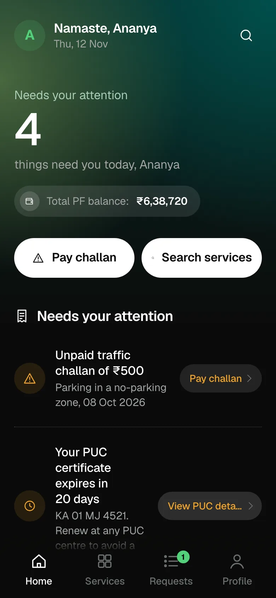
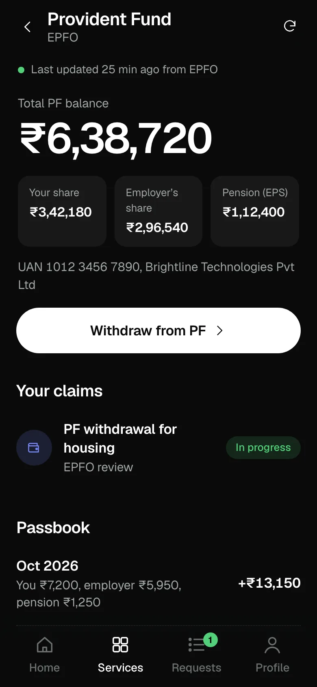
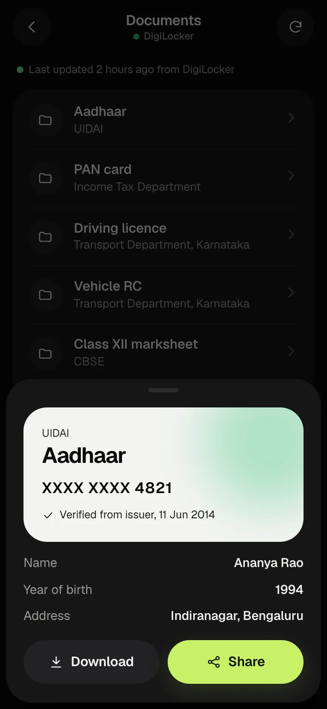
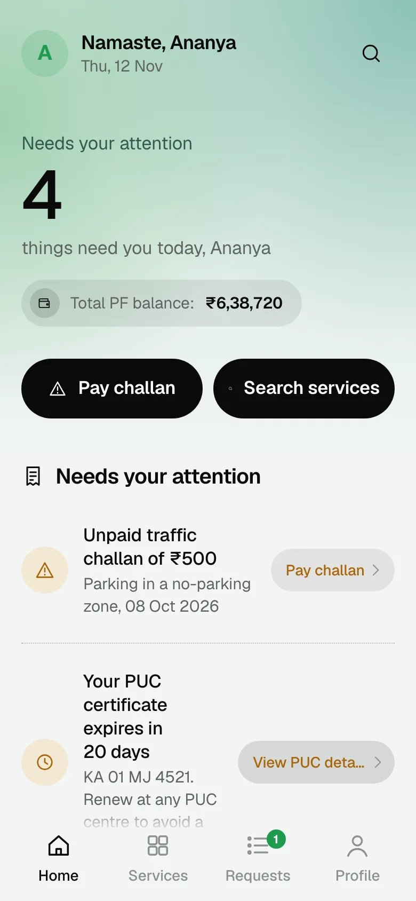
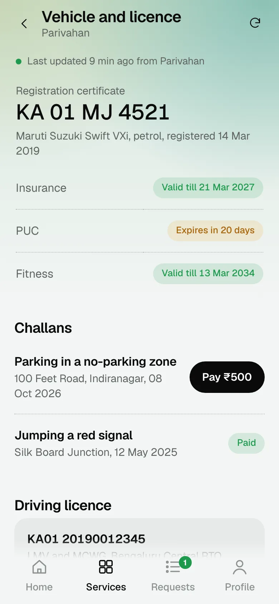
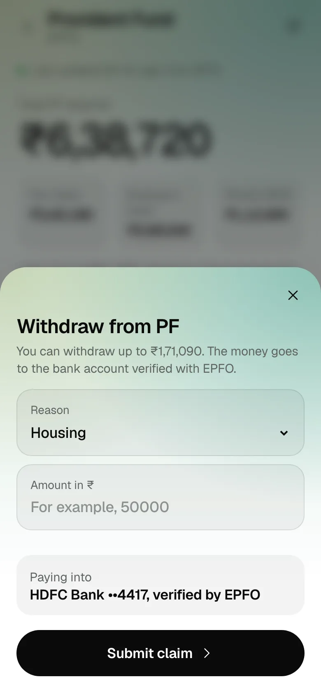

# Aasaan

**One sign-in for PF, documents, vehicle, tax and health.** Aasaan is a working prototype of a citizen-services app for India: check your provident fund, pay a traffic challan, share a verified document, track a tax refund and decide who sees your health records, all from one place.

> [!IMPORTANT]
> Aasaan is an **independent design prototype**. It is not a government app, it is not affiliated with any department, and every record in it is **sample data**. No real government APIs are connected and nothing you enter leaves your device.

<p align="center">
  
  
  
</p>
<p align="center">
  
  
  
</p>

## Contents

- [What it does](#what-it-does)
- [Try it](#try-it)
- [Getting started](#getting-started)
- [Scripts](#scripts)
- [How it is built](#how-it-is-built)
- [Connecting real department APIs](#connecting-real-department-apis)
- [Design system](#design-system)
- [Accessibility](#accessibility)
- [Testing](#testing)
- [Project structure](#project-structure)
- [Project rules](#project-rules)
- [Status](#status)

## What it does

| Service | Department | What you can do |
|---|---|---|
| Provident Fund | EPFO | See your balance and its split, read the passbook, and file a withdrawal claim. Amounts are validated: required, at least ₹1,000, and no more than you are eligible for. |
| Documents | DigiLocker | View verified documents, and create share codes that expire after 1 hour, 1 day or 7 days. Codes can be revoked early. |
| Vehicle and licence | Parivahan | Check RC, PUC, insurance and fitness validity, see your driving licence, and pay a challan with a receipt. |
| Income tax | Income Tax Department | See your PAN and Aadhaar link status, return status and refund timeline. |
| Health ID | ABDM | See your ABHA card, allow or deny requests to see your records, and browse your records. |

Across all five:

- **Home** leads with what needs you today: a count, an urgency meter, the departments involved, and a card for each item with its next action.
- **Requests** tracks everything you have applied for or paid, in every department, each with a timeline.
- **Search** works in English and Hindi, for example "pay challan" or "चालान".
- **Language and appearance:** switch between English and हिन्दी, and between light, dark or the device setting.
- **When a department is down**, Aasaan shows your last synced data with the time it was updated, saves submissions on your phone, and sends them automatically when the department is back. Profile has prototype switches to simulate an outage for each department.

## Try it

Sign in with any 10-digit mobile number starting with 6, 7, 8 or 9. The demo OTP is **123456**.

Things worth trying:

1. **Pay the challan** from the first card on Home and watch the count drop.
2. **Simulate an EPFO outage** in Profile, then open Provident Fund and file a claim. It waits in Requests as Queued and survives a reload. Switch the outage off and the claim is sent on its own.
3. **Share a document** from Documents, then revoke the code.
4. **Allow or deny** the hospital's request to see your records in Health ID.
5. **Reset sample data** in Profile to start again.

## Getting started

Requirements: **Node.js 22.12 or later** (Vitest needs it; Vite alone runs on 20.19+) and npm.

```bash
git clone https://github.com/keyushhh/aasaan.git
cd aasaan
npm install
npm run dev
```

Open the address Vite prints, usually `http://localhost:5173`. The app is designed for phone widths; in desktop browsers, use device emulation at 390×844.

For end-to-end tests and screenshots, install Playwright's browser once:

```bash
npx playwright install chromium
```

## Scripts

| Command | What it does |
|---|---|
| `npm run dev` | Start the dev server with hot reload |
| `npm run build` | Type-check and build to `dist/` |
| `npm run preview` | Serve the production build locally |
| `npm run typecheck` | Type-check only |
| `npm test` | Unit and UI tests (Vitest and Testing Library) |
| `npm run e2e` | End-to-end flows in Chromium (Playwright) |
| `npm run parity` | Side-by-side screenshots of the original prototype and the app, with a pixel count |
| `npm run screenshots` | Regenerate the README screenshots in `docs/screenshots` (needs `cwebp`) |

## How it is built

- **React 19, TypeScript and Vite.**
- **React Router** with hash URLs (`#/epf`, `#/docs`), so the build runs on any static host.
- **TanStack Query** for server state.
- **CSS Modules** with a single token file. There is no UI component library; the component set is our own.

### Data layer

Every department is reached through a typed interface, and the UI never talks to a department directly.

```
UI (features/*)
  └─ hooks (data/hooks.ts)          TanStack Query: caching, refetch, optimistic updates
       └─ api (data/index.ts)       picks the adapters, registers outbox handlers
            └─ department.ts        outage state, last-synced fallback, outbox, recovery
                 └─ adapters        mock today (data/mock); real ones later
```

- **Every call can fail with `DepartmentUnavailable`.**
- **Reads fall back to the last synced copy** when a department is down, and the screen shows when that copy was taken.
- **Submissions that can wait**, such as a PF claim, go to a **persistent outbox** while the department is down. They are sent in order when it recovers, and a `recovered` event tells the UI how many went through.
- **Actions that need an answer now** fail with a clear message instead. These are paying a challan, issuing a share code and answering a records request.
- **Persistence** goes through `lib/storage.ts`, which guards every read and write so a full or blocked storage never breaks the app.

## Connecting real department APIs

The interfaces live in `src/data/services.ts`: `EpfService`, `DocumentsService`, `VehicleService`, `TaxService`, `HealthService`, `RequestsService` and `AuthService`. To add real ones (API Setu, DigiLocker, Parivahan, ABDM, EPFO):

1. **Implement `Adapters`** in a new folder, for example `src/data/live/`. Throw `DepartmentUnavailable` when a department cannot be reached.
2. **Register it** in `SOURCES` in `src/data/index.ts`.
3. **Run with `VITE_DATA_SOURCE=live`.**

With a live source, a successful read marks the department as synced, and the department's up or down state follows its real responses. The prototype outage switches are only needed for the mock. No component changes.

## Design system

- **Tokens:** every colour, radius, shadow, motion and type value lives in `src/tokens/tokens.css`, in light and dark sets. Profile → Appearance picks System, Light or Dark. System follows the device; the other two set `data-theme` on `<html>`.
- **Surfaces:** an audit console. A near-black ground (pale grey in light mode) with one deep-teal glow at the top, flat surfaces a shade lighter than the ground, and rows divided by dotted hairlines. The main action on each screen is a solid high-contrast pill; amber marks anything worth checking, green anything confirmed.
- **Type:** Geist for Latin script and Mukta for Devanagari, both self-hosted. Labels are sentence case.
- **Departments:** each has one colour, used for its round marker only, never for whole surfaces.
- **Components** live in `src/components`: Button, IconButton, Card, Row, Pill, Switch, Segmented, Sheet, Toast, Timeline, TabBar, ServiceTile, AlertCard, Banner, Skeleton, TopBar, Field and KeyValue.
- **Motion:** one entrance moment on Home, a 1px lift on hover and a press on buttons, a 2px lift on cards. Hover effects apply only on fine pointers, nothing animates on scroll, and reduced motion turns everything still.

## Accessibility

- **Focus and structure:** a skip link on every screen, an `h1` on every screen, and a visible focus ring.
- **Targets and actions:** tap targets of at least 44px, and one filled primary button per view.
- **Sheets** are native modal dialogs. Focus stays inside, Escape closes them, and focus returns to the control that opened them.
- **Live updates:** toasts are announced through a persistent live region, and form errors through `role="alert"`.
- **Language:** the `lang` attribute follows the selected language, so Hindi is read correctly.

## Testing

- **Unit and UI** (`npm test`, 23 tests):
  - claim validation: empty, under ₹1,000, over the eligible limit;
  - outage queueing and automatic sending on recovery;
  - challan payment, and refusal while Parivahan is down;
  - creating, expiring and revoking share codes;
  - allowing and denying records requests;
  - switching between light, dark and system appearance.

  UI tests render the whole app and drive it through the screens.
- **End to end** (`npm run e2e`, 6 flows): sign-in with its errors, paying from Home, a queued claim surviving a reload and sending on recovery, sharing and revoking, Hindi search and language switching, and keyboard access with focus kept inside sheets.

## Project structure

```
reference/index.html    the original single-file prototype: the baseline for behaviour and copy
src/
  app/                  shell, routes, navigation, session and language
  components/           the component set (one .tsx and .module.css each)
  data/                 department interfaces, adapters, outage, outbox, query hooks
    mock/               sample data and mock adapters with realistic latency
  features/             one folder per screen: auth, home, epf, documents, vehicle,
                        tax, health, requests, search, profile
  i18n/strings.ts       every word the UI shows, in English and Hindi
  lib/                  formatting and the storage module
  tokens/               design tokens and global styles
e2e/                    Playwright flows, parity and README screenshots
docs/screenshots/       images used in this README
```

## Project rules

These hold for every change. `AGENTS.md` has the full list.

- **Copy:** every word comes from `src/i18n/strings.ts`, with no hard-coded copy in components. Plain sentence case, buttons as a verb plus an object, no em dashes, no exclamation marks.
- **Disclaimer:** the app never presents itself as an official government app. The prototype and sample-data note stays on login and profile.
- **Styling:** components use tokens, never raw colour values.
- **Reference file:** `reference/index.html` is never edited.

## Status

A working prototype on sample data, in active development. The interface is being refined next. Real department integrations are planned behind the existing interfaces.
